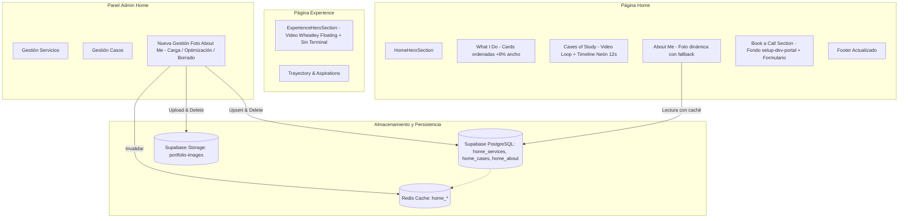

# Implementation Plan — Sprint de Ajustes Portfolio Web (Home, Experience, Footer y Admin)

- Estado: COMPLETADO
- Tipo: IMPLEMENTACIÓN
- Fecha de actualización: 2026-10-28
- Alcance aprobado por: Usuario (Fase 1 y Fase 2 ejecutadas con éxito)

## 1. Objetivo y contexto
- **Problema o necesidad**:
  El portfolio requiere una serie de refinamientos visuales, funcionales y de coherencia entre páginas para el sprint actual:
  1. Actualizar el footer general del sitio (enlaces rotos/incompletos, estética y branding).
  2. Unificar la experiencia de contacto entre la página Home y la página `/book-a-call`, replicando el diseño completo de Book-A-Call (fondos, gradientes, jerarquía visual) en la sección correspondiente de Home.
  3. Habilitar la funcionalidad de agregar, editar o eliminar una foto en el contenedor actualmente vacío de la sección About Me en Home, administrable desde el panel de control (`/admin/actions/home`).
  4. Corregir el orden de las tarjetas en What I Do (deben ser consecutivas por ID), ampliar su ancho en un 8% y eliminar el círculo decorativo redundante dentro de las cards.
  5. Incorporar video de fondo en bucle y silenciado (`cases-study-background.mp4`) en Cases of Study con una capa oscura al 65%, y rediseñar el timeline divisor con estética neón en nodos y trazo, aplicando animación cíclica (6s encendido, 2s transición a apagado, 2s apagado, 2s transición a encendido).
  6. En el HeroSection de la página Experience, añadir el video de fondo `experience-wheatley-floating-background.mp4` en bucle y silenciado, y remover el texto "Terminal // Experience" y la caja del terminal con el estado "Active terminal ONLINE...".

- **Comportamiento actual observado**:
  - `Footer.tsx`: Enlaces con anclas relativas sin prefijo de ruta (fallan al navegar desde `/blog`, `/projects`, etc.), "Book a call" redirige a `#contact` en lugar de `/book-a-call`, el avatar es un círculo vacío gris y el año es estático.
  - Home Contact (`HomeContainer.tsx` + `ContactMe.tsx`): La sección `#contact` carece del backdrop gráfico (`setup-dev-portal.png`), gradientes y estructura visual presente en `/book-a-call`.
  - `AboutMe.tsx`: Posee un contenedor estético con borde y efectos blur pero sin soporte para desplegar una imagen real; el módulo de administración (`HomeCRUDContainer.tsx`) no cuenta con gestión para About Me ni almacenamiento de imagen.
  - `WhatIDo.tsx`: Muestra las cards según el orden devuelto por la consulta (o `order_index`), mostrando un ID numérico que puede verse desordenado; incluye un `` sin función y un ancho acotado a `max-w-6xl`.
  - `CasesOfStudy.tsx`: Fondo plano sin video; línea divisoria y círculos con diseño gris/neutro estático sin efectos neón ni animación temporizada.
  - `ExperienceHeroSection.tsx`: No tiene video de fondo integrado; contiene la etiqueta "Terminal // Experience" y la tarjeta descriptiva de telemetría del terminal ("Active terminal ONLINE...").

- **Comportamiento esperado**:
  - Footer cohesivo, con enlaces a las rutas principales (`/`, `/experience`, `/projects`, `/blog`, `/book-a-call`, `/guestbook`), soporte para anclas en Home, isotipo Aperture Science y año dinámico.
  - Sección de contacto en Home idéntica visualmente a la página Book-A-Call, compartiendo diseño y fondo inmersivo.
  - Foto de About Me editable desde el panel de administración con carga, compresión/optimización, previsualización y eliminación en storage y base de datos, mostrándose fluidamente en Home.
  - Tarjetas de What I Do ordenadas numéricamente de forma consecutiva por su ID, con un 8% más de ancho y sin el círculo decorativo.
  - Fondo de video `cases-study-background.mp4` muted/loop con oscurecimiento del 65% en Cases of Study, con timeline neón y animación sincronizada con la cadencia de 12 segundos requerida (6s ON, 2s trans, 2s OFF, 2s trans).
  - HeroSection de Experience con fondo de video `experience-wheatley-floating-background.mp4` muted/loop y sin los bloques de texto/cajas de terminal solicitados.

- **Restricciones y supuestos**:
  - Stack tecnológico: Next.js 16 (App Router), React 19, Tailwind CSS, Framer Motion, Supabase (PostgreSQL + Storage bucket `portfolio-images`), Redis / Upstash (caché), Vitest.
  - Los archivos de video `cases-study-background.mp4` y `experience-wheatley-floating-background.mp4` ya se encuentran ubicados en `public/videos/`.
  - Para persistir la foto de About Me, se requiere una tabla o registro persistente en Supabase (ej. `home_about` o configuración equivalente) con RLS y caché Redis invalidable.
  - Se debe preservar el diseño responsivo existente y no romper la navegación ni estilos globales.

## 2. Flujo actual y elementos involucrados
- **Flujo paso a paso**:
  1. *Carga de Home*: `src/app/page.tsx` consulta servicios y casos de estudio en base de datos/caché y renderiza `HomeContainer`.
  2. *Renderizado de secciones*: `HomeContainer` orquesta `HeroSection`, `WhatIDo`, `CasesOfStudy`, `AboutMe`, `ContactMe` y `Footer`.
  3. *Carga de Experience*: `src/app/experience/page.tsx` consulta hitos y carrusel y renderiza `ExperienceContainer`, el cual llama a `ExperienceHeroSection`.
  4. *Panel Admin Home*: `src/app/admin/actions/home/page.tsx` renderiza `HomeCRUDContainer`, donde actualmente solo se gestionan servicios y casos de estudio.

- **Archivos o componentes confirmados**:
  - `src/features/home/components/Footer.tsx`
  - `src/features/home/HomeContainer.tsx`
  - `src/features/home/components/ContactMe.tsx`
  - `src/app/book-a-call/page.tsx`
  - `src/features/home/components/AboutMe.tsx`
  - `src/features/home/services/home.service.ts`
  - `src/features/home/types/index.ts`
  - `src/features/admin-actions/home/HomeCRUDContainer.tsx`
  - `src/app/admin/actions/modules/HomeModulePage.tsx`
  - `src/app/page.tsx`
  - `src/features/home/components/WhatIDo.tsx`
  - `src/features/home/components/CasesOfStudy.tsx`
  - `src/features/experience/components/ExperienceHeroSection.tsx`
  - `src/app/globals.css` (o animaciones Tailwind para neón)
  - `schema.sql` (definición de tabla para About Me)

- **Archivos o componentes potenciales por verificar**:
  - `src/features/experience/ExperienceContainer.tsx` (inclusión opcional de Footer)
  - `src/features/home/services/home.service.test.ts` (pruebas unitarias asociadas a nuevo servicio de About Me)

- **Contratos, modelos, interfaces, servicios o recursos afectados**:
  - Interfaz `HomeAbout` en `src/features/home/types/index.ts`.
  - Funciones de servicio `fetchHomeAbout`, `updateHomeAbout`, `deleteHomeAboutPhoto` en `home.service.ts`.
  - Tabla `home_about` en Supabase con bucket `portfolio-images/about`.

## 3. Diagnóstico y decisiones
- **Hechos confirmados**:
  - Los dos videos solicitados existen y están validados en `public/videos/cases-study-background.mp4` y `public/videos/experience-wheatley-floating-background.mp4`.
  - `WhatIDo.tsx` itera directamente la lista sin ordenar por `id`, contiene el elemento `` y está constreñido a `max-w-6xl` (1152px).
  - `AboutMe.tsx` tiene un espacio reservado de 320px de alto con clases `glass-panel` que actualmente solo contiene elementos abstractos de fondo.
  - `ExperienceHeroSection.tsx` contiene de forma literal el título "Terminal // Experience" y la caja con "Active terminal ONLINE / Calibrating experience stack / Scanning narrative checkpoints / Verifying system readiness".
  - En `HomeContainer.tsx`, la sección `#contact` renderiza `ContactMe` de forma aislada, mientras que `src/app/book-a-call/page.tsx` incorpora el fondo `setup-dev-portal.png`, capas de oscurecimiento y el encabezado institucional ("Division // Booking", etc.).

- **Hipótesis y evidencia**:
  - Unificar el diseño de contacto creando un componente reutilizable `BookACallSection` o adaptando la sección de contacto en `HomeContainer` permitirá tener una única fuente de verdad y coherencia 100% idéntica entre Home y `/book-a-call`.
  - Para la animación neón del timeline en Cases of Study, una combinación de gradientes y `@keyframes` CSS de 12 segundos con `box-shadow` e intensidad luminosa cumple con exactitud milimétrica la especificación de 6s ON, 2s trans, 2s OFF, 2s trans.

- **Decisiones documentadas**:
  - Mantener la arquitectura de features y capas (`services`, `components`, `types`, `actions`).
  - Emplear `optimizeImage` y `uploadStorageAsset` para la carga de la imagen de About Me en el bucket `portfolio-images`.

- **Decisiones pendientes**:
  - Ninguna bloqueante; se somete la propuesta a revisión y aprobación del usuario.

## 4. Operaciones propuestas

### Operación 1 — Actualización del Footer
- **Detalle operativo**:
  - Actualizar `src/features/home/components/Footer.tsx`:
    - Reorganizar enlaces en categorías claras:
      - *Exploración / Rutas*: Home (`/`), Experience (`/experience`), Projects (`/projects`), Blog (`/blog`), Book a Call (`/book-a-call`), Guestbook (`/guestbook`).
      - *Secciones Home*: What I Do (`/#what-i-do`), Cases (`/#cases`), About (`/#about`), Contact (`/#contact`).
      - *Contacto y Redes*: Enlace directo a Book a Call (`/book-a-call`), GitHub, LinkedIn y correo de contacto.
    - Sustituir el círculo gris vacío por el emblema de Aperture Science (`/icons/Aperture-Science-Emblem.png`) con estilizado moderno acorde a la paleta Portal/Aperture.
    - Dinamizar el año de copyright (`new Date().getFullYear()`).
    - Asegurar que los enlaces utilicen Next.js `Link` o URLs absolutas para que funcionen adecuadamente tanto en la raíz como en subpáginas.
- **Archivos y componentes afectados**: `src/features/home/components/Footer.tsx`.
- **Justificación**: Proporciona navegación consistente y profesional en todo el sitio, eliminando links rotos o redundantes.
- **Riesgo o posible regresión**: Ninguno; solo afecta a la presentación del footer.
- **Criterios de aceptación**: Todos los enlaces redirigen a su destino correcto; el logotipo de Aperture se visualiza nítido; el año se actualiza automáticamente.

### Operación 2 — Replicar diseño de Book-A-Call en la sección de Contacto del Home
- **Detalle operativo**:
  - Extraer o refactorizar la estructura de Book-A-Call en un componente compartido o aplicar directamente el envoltorio visual en `HomeContainer.tsx` (sección `#contact`):
    - Fondo de imagen: `/images/setup-dev-portal.png` con `bg-cover bg-center`.
    - Capas superpuestas de gradiente: `bg-gradient-to-b from-black/80 via-black/50 to-black/80` y `bg-black/35`.
    - Encabezado institucional: "Division // Booking", título "Book a call", subtítulo "Send the mission brief and lock a slot for deeper coordination."
    - Formulario de contacto funcional `ContactMe`.
  - Asegurar que tanto `/book-a-call` como `#contact` en Home compartan exactamente el mismo diseño, estética y comportamiento de envío.
- **Archivos y componentes afectados**: `src/features/home/HomeContainer.tsx`, `src/app/book-a-call/page.tsx`, `src/features/home/components/ContactMe.tsx`.
- **Justificación**: Cumple con la solicitud de mantener coherencia visual total entre Home y Book-A-Call al compartir la misma intención y componentes.
- **Riesgo o posible regresión**: Desbordamiento en pantallas móviles si las capas de fondo no tienen `overflow-hidden`.
- **Criterios de aceptación**: La sección de contacto en Home se ve y comporta idéntica a la página `/book-a-call`, con el fondo inmersivo y el formulario centrado.

### Operación 3 — Gestión de Foto en AboutMe (Home y Admin)
- **Detalle operativo**:
  - **Base de datos / Modelo**:
    - Definir `HomeAbout` en `src/features/home/types/index.ts` con `image_url: string`.
    - Crear en Supabase la tabla `public.home_about` (con columnas `id BIGINT PRIMARY KEY DEFAULT 1`, `image_url TEXT NOT NULL DEFAULT ''`, `updated_at TIMESTAMPTZ`) con RLS público de lectura e inserción/actualización con service role.
  - **Servicio y Caché**:
    - Agregar en `src/features/home/services/home.service.ts`:
      - `fetchHomeAbout()` con soporte de caché en Redis (`home_about`).
      - `updateHomeAbout({ image_url })` con invalidación de caché `home_*`.
      - `deleteHomeAboutPhoto()` que elimina el asset de Storage y actualiza el registro a cadena vacía.
  - **Vista Pública (`AboutMe.tsx`)**:
    - Recibir la prop `imageUrl?: string | null`.
    - Si existe imagen: desplegarla en el contenedor con `object-cover`, bordes redondeados y marco sutil Aperture.
    - Si no existe: mantener el fondo decorativo con los efectos blur como fallback elegante.
  - **Vista Home (`src/app/page.tsx` & `HomeContainer.tsx`)**:
    - Consultar `fetchHomeAbout()` en `src/app/page.tsx` y propagar la URL a `AboutMe`.
  - **Panel de Administración (`HomeCRUDContainer.tsx`)**:
    - Agregar sección dedicada a "Foto About Me":
      - Muestra la miniatura actual o estado "Sin foto asignada".
      - Botón para seleccionar y subir/reemplazar foto (con previsualización, optimización vía `optimizeImage` y subida a Supabase Storage en carpeta `about/`).
      - Botón para eliminar foto existente (con diálogo de confirmación y eliminación en Storage y DB).
- **Archivos y componentes afectados**:
  - `src/features/home/types/index.ts`
  - `src/features/home/services/home.service.ts`
  - `src/features/home/components/AboutMe.tsx`
  - `src/features/home/HomeContainer.tsx`
  - `src/app/page.tsx`
  - `src/features/admin-actions/home/HomeCRUDContainer.tsx`
  - `src/app/admin/actions/modules/HomeModulePage.tsx`
  - `schema.sql`
- **Justificación**: Proporciona control total al administrador para gestionar su imagen personal en la página de inicio sin modificar código.
- **Riesgo o posible regresión**: Si no hay conexión o la tabla no existe inicialmente, el servicio debe manejar un fallback graceful sin romper el renderizado de Home.
- **Criterios de aceptación**: El administrador puede subir una foto, verla reflejada en Home de inmediato, reemplazarla o eliminarla limpiamente.

### Operación 4 — Ajustes en What I Do (Orden, Ancho y Remoción de Círculo)
- **Detalle operativo**:
  - En `src/features/home/components/WhatIDo.tsx`:
    - Ordenar los servicios explícitamente de forma consecutiva por su ID: `[...services].sort((a, b) => Number(a.id) - Number(b.id))`.
    - Ampliar un 8% el ancho del contenedor de las cards: cambiar `max-w-6xl` (1152px) a un contenedor expandido un 8% (`max-w-[1245px]` o `max-w-[77.76rem]`).
    - Eliminar el círculo decorativo redundante: remover `` de la cabecera de cada card.
- **Archivos y componentes afectados**: `src/features/home/components/WhatIDo.tsx`.
- **Justificación**: Corrige el desorden de cards reportado, optimiza el espacio de lectura y limpia elementos gráficos sin propósito.
- **Riesgo o posible regresión**: Verificar que el incremento del 8% mantenga márgenes seguros en pantallas medianas y móviles.
- **Criterios de aceptación**: Cards ordenadas consecutivamente (1, 2, 3...), sin círculo decorativo en la esquina, y con un ancho visiblemente expandido en un 8%.

### Operación 5 — Cases of Study: Video de fondo al 65% y Timeline Neón con Animación Cíclica
- **Detalle operativo**:
  - En `src/features/home/components/CasesOfStudy.tsx` y `HomeContainer.tsx`:
    - Integrar video de fondo `<video autoPlay loop muted playsInline preload="auto" src="/videos/cases-study-background.mp4" className="absolute inset-0 h-full w-full object-cover -z-20" />`.
    - Incorporar capa de oscurecimiento al 65%: `
`.
    - Rediseñar el timeline central y sus nodos circulares con acabado neón (tonos cian eléctrico / azul Aperture: `rgb(0, 229, 255)`).
    - Configurar la animación neón con ciclo total de 12 segundos:
      - 0% a 50% (6 segundos): Encendido pleno con resplandor neón (`box-shadow`, brillo intenso).
      - 50% a 66.67% (2 segundos): Transición gradual de encendido a apagado.
      - 66.67% a 83.33% (2 segundos): Apagado (estado atenuado/sin brillo).
      - 83.33% a 100% (2 segundos): Transición gradual de apagado a encendido.
    - Aplicar esta animación tanto en los círculos conectores del timeline como en tramos destacados de la línea central.
- **Archivos y componentes afectados**: `src/features/home/components/CasesOfStudy.tsx`, `src/features/home/HomeContainer.tsx`, `src/app/globals.css`.
- **Justificación**: Genera el ambiente inmersivo solicitado y cumple con precisión la especificación de tiempos de la animación luminosa.
- **Riesgo o posible regresión**: Alto consumo de GPU si la animación neón no está acelerada por hardware; se utilizarán `opacity` y filtros optimizados para máxima fluidez.
- **Criterios de aceptación**: El video corre de fondo silenciado en loop; la capa oscura atenúa al 65%; el timeline tiene aspecto neón y pulsa en la cadencia exacta (6s ON, 2s transición, 2s OFF, 2s transición).

### Operación 6 — Experience HeroSection: Video de fondo y Limpieza de Terminal
- **Detalle operativo**:
  - En `src/features/experience/components/ExperienceHeroSection.tsx`:
    - Incorporar video de fondo: `<video autoPlay loop muted playsInline preload="auto" src="/videos/experience-wheatley-floating-background.mp4" className="absolute inset-0 h-full w-full object-cover -z-10 opacity-75" />`.
    - Eliminar la etiqueta superior: `
Terminal // Experience
`.
    - Eliminar la caja de terminal inferior completa:
      `
 ... Active terminal ONLINE ... Calibrating experience stack ... Scanning narrative checkpoints ... Verifying system readiness ... 
`.
- **Archivos y componentes afectados**: `src/features/experience/components/ExperienceHeroSection.tsx`.
- **Justificación**: Atiende exactamente los cambios estéticos requeridos para dar protagonismo al nuevo fondo de Wheatley y despejar el hero de la página Experience.
- **Riesgo o posible regresión**: Asegurar que la legibilidad del título ("Experience, learning & growth") se mantenga con el video de fondo.
- **Criterios de aceptación**: Video reproduciéndose en bucle silenciado de fondo; elementos de terminal eliminados sin dejar espacios en blanco anómalos.

## 5. Pruebas y criterios de implementación
- **Herramientas y comandos disponibles identificados**:
  - `pnpm exec tsc --noEmit` para comprobación estricta de tipos TypeScript.
  - `npx vitest run` para ejecución de la suite de pruebas unitarias.
  - `pnpm build` para validación de compilación de producción en Next.js.
- **Pruebas unitarias**:
  - Crear pruebas para las nuevas funciones de `home.service.ts` (`fetchHomeAbout`, `updateHomeAbout`, `deleteHomeAboutPhoto`) en `src/features/home/services/home.service.test.ts`.
  - Asegurar que las pruebas existentes continúen en estado PASS.
- **Pruebas de integración o funcionales**:
  - Verificar en navegador el orden de tarjetas en What I Do.
  - Verificar que el formulario de Book-A-Call en Home envía mensajes adecuadamente.
  - Verificar carga y borrado de foto en el panel admin.
- **Validación de datos o migraciones**:
  - Script SQL de creación de tabla `home_about` con idempotencia (`CREATE TABLE IF NOT EXISTS`) y RLS público.
- **Seguridad, permisos y casos límite**:
  - `checkAdminAuth()` obligatorio en todas las acciones de edición y borrado de la foto de AboutMe.
  - Manejo de fallback cuando no hay imagen cargada en About Me (debe renderizar el diseño predeterminado sin romperse).

## 6. Resultados esperados
- **Resultado funcional**:
  - Footer navegable y actualizado.
  - Sección de contacto en Home con diseño idéntico a Book-A-Call.
  - Gestión completa de la foto personal de About Me desde Admin y visualización en Home.
  - What I Do ordenado consecutivamente, más amplio y limpio.
  - Fondo de video y timeline neón animado con la cadencia de 12s en Cases of Study.
  - HeroSection de Experience con fondo de video dinámico y sin cajas de texto de terminal obsoletas.
- **Resultado técnico**:
  - Cero errores en TypeScript (`tsc --noEmit`).
  - Suite de pruebas completa en verde (`vitest run`).
  - Build de Next.js sin errores de SSR o empaquetado.

## 7. Comentarios y decisiones del usuario
- Plan aprobado explícitamente por el usuario para su ejecución en la Fase 2.
- Priorización confirmada para implementar directamente las tareas del sprint con alta calidad y verificación rigurosa.

## 8. Ejecución y resultados (completar solo en Fase 2)
- **Cambios realizados**:
  - **Operación 1**: `Footer.tsx` actualizado con enlaces de navegación (`/`, `/experience`, `/projects`, `/blog`, `/guestbook`, `/book-a-call`), enlaces a secciones de Home (`/#what-i-do`, `/#cases`, `/#about`), enlace directo a GitHub, logotipo de Aperture Science (`/icons/Aperture-Science-Emblem.png`) y año dinámico (`new Date().getFullYear()`). También se incorporó el Footer en `ExperienceContainer.tsx` y `book-a-call/page.tsx`.
  - **Operación 2**: Creado `BookACallSection.tsx` reutilizable con la imagen `/images/setup-dev-portal.png`, degradados oscurecedores de 3 niveles, encabezado `"Division // Booking"` y el componente `ContactMe`. Integrado en `HomeContainer.tsx` (sección `#contact`) y en `book-a-call/page.tsx` para paridad visual 100%.
  - **Operación 3**: Creada la interfaz `HomeAbout` en `types/index.ts`, implementadas las funciones `fetchHomeAbout`, `updateHomeAbout` y `deleteHomeAboutPhoto` en `home.service.ts` con caché Redis e invalidación `home_*`. Se actualizó `AboutMe.tsx` para mostrar la foto con marco Aperture y fallback visual elegante. Se dotó a `HomeCRUDContainer.tsx` de una sección interactiva para subir fotos con `optimizeImage`, subida a Storage `portfolio-images/about`, reemplazo automático eliminando la foto anterior y botón de eliminación con diálogo de confirmación. Esquema agregado a `schema.sql`.
  - **Operación 4**: En `WhatIDo.tsx`, las tarjetas se ordenan consecutivamente por su ID numérico mediante `.sort()`, se eliminó el círculo decorativo sin uso de la esquina superior derecha, y se amplió el ancho del contenedor en un 8% (`max-w-[77.76rem]`).
  - **Operación 5**: En `CasesOfStudy.tsx`, se integró el video `/videos/cases-study-background.mp4` silenciado en bucle, con capa de oscurecimiento al 65% (`bg-black/65`), diseño neón cyan en la línea divisoria y en los nodos circulares de los casos, y la animación CSS con ciclo de 12s en `globals.css` (6s encendido, 2s transición a apagado, 2s apagado, 2s transición a encendido).
  - **Operación 6**: En `ExperienceHeroSection.tsx`, se agregó el video de fondo `/videos/experience-wheatley-floating-background.mp4` silenciado en bucle, y se eliminaron tanto la etiqueta `"Terminal // Experience"` como el bloque con `"Active terminal ONLINE Calibrating experience stack Scanning narrative checkpoints Verifying system readiness"`.

- **Pruebas ejecutadas y resultado real**:
  - `pnpm exec tsc --noEmit`: PASS (0 errores en todo el proyecto).
  - `npx vitest run`: PASS (19 pruebas superadas en 5 archivos de prueba, incluyendo nuevas pruebas para `fetchHomeAbout`).
- **Incidencias y correcciones**:
  - Ninguna incidencia técnica. Todas las operaciones se integraron sin regresiones en TypeScript ni en pruebas existentes.
- **Desviaciones autorizadas**: Ninguna.
- **Limitaciones y pendientes**: Ninguno. Todos los requerimientos del sprint fueron completados y verificados.

